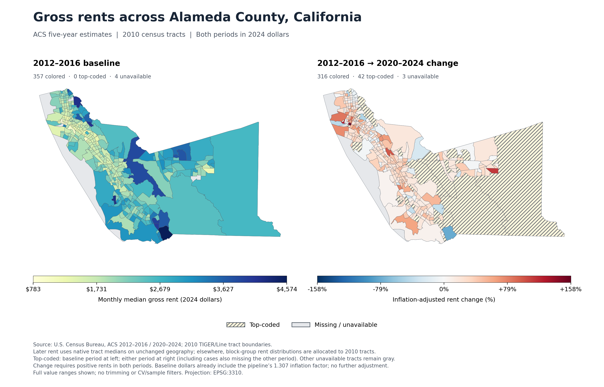

# ACS tract pipeline

This ADU Rent stage prepares 2012–2016 and 2020–2024 ACS rent, rental
inventory, change measures, and covariates for a panel of 2010 census tracts.
It combines native tract estimates with 2024 block-group measures allocated to
2010 tracts, using geographic consistency to select the final 2024 source.
Assembly covers five Southern California and nine Bay Area counties; the
[county definitions and panel contract](schemas/acs_full.md) specify that scope.
ACS imports and the tract-consistency crosswalk are statewide. Downstream
analysis stages apply their own sample restrictions; see the
[shared pipeline](../../PIPELINE.md).
Notebook 5 demonstrates the cleaned rent measures with paired static maps,
independent of parcel data and downstream analysis samples.

## Notebook overview

- [01_import_acs.Rmd](01_import_acs.Rmd) imports statewide ACS estimates and original rent
  evidence for 2016 tracts and 2024 tracts/block groups, plus NHGIS crosswalks.
- [02a_build_measures_from_block_groups.Rmd](02a_build_measures_from_block_groups.Rmd)
  allocates 2024 block-group measures to target-county 2010 tracts and derives
  rent, rental inventory, and covariates.
- [02b_build_measures_from_tracts.Rmd](02b_build_measures_from_tracts.Rmd) prepares both
  vintages on native tract keys, with rental inventory and rent metadata.
  It and 02a can run in either order after 01.
- [03_identify_tract_boundary_changes.Rmd](03_identify_tract_boundary_changes.Rmd) identifies geographically consistent
  2010–2020 tract links from statewide Census intersections. It runs independently
  of Steps 1–2, or its validated crosswalk can be reused.
- [04_assemble_tract_panel.Rmd](04_assemble_tract_panel.Rmd) combines all three Step 2 products and the Step 3
  crosswalk, selects 2024 measurements by geographic consistency, and calculates
  panel changes and source comparisons.
- [05_map_tract_rents.ipynb](05_map_tract_rents.ipynb) maps baseline monthly gross
  rent and subsequent real percentage change on 2010 tracts, with explicit
  top-coded and unavailable display statuses. It reads the saved Step 4 panel;
  Alameda County is the default.

## Step 1: Import ACS data

Notebook: [01_import_acs.Rmd](01_import_acs.Rmd). Import statewide ACS estimates, original
B25064 rent evidence, and NHGIS allocation crosswalks without sample filtering.

**Inputs:**

- Census ACS 5-year API via `tidycensus`: 2012–2016 tracts and 2020–2024
  tracts/block groups, California.
- `../../../data-raw-temp/nhgis/nhgis_bg2020_tr2010_06/nhgis_bg2020_tr2010_06.csv`
  — 2020 block groups to 2010 tracts.
- `../../../data-raw-temp/nhgis/nhgis_tr2000_tr2010_06/nhgis_tr2000_tr2010_06.csv`
  — 2000 tracts to 2010 tracts.

**Outputs:**

- `../../../data/acs_step1_2016_tract.feather` — 2012–2016 estimates on
  `tr2010_id`; [schema](schemas/acs_step1_2016_tract.md).
- `../../../data/acs_step1_2024_block_group.feather` — 2020–2024 estimates on
  `bg2020_id`; [schema](schemas/acs_step1_2024_block_group.md).
- `../../../data/acs_step1_2024_tract.feather` — 2020–2024 estimates on
  `tr2020_id`; [schema](schemas/acs_step1_2024_tract.md).
- `../../../data/xwalk_bg24_tr10.feather` — block-group allocation links and
  weights; [schema](schemas/xwalk_bg24_tr10.md).
- `../../../data/xwalk_tr00_tr10.feather` — 2000-to-2010 tract allocation links
  and weights; [schema](schemas/xwalk_tr00_tr10.md). Not consumed by Steps 2–4.

**Steps:**

1. Define ACS variables, retaining rent-distribution and inventory components; omit unavailable bedroom-rent measures from the block-group request.
2. Download 2012–2016 tract estimates and original rent evidence, check uncertainty, and save on 2010 tract keys.
3. Download 2020–2024 block-group estimates and rent evidence, validate the requested fields and keys, and save.
4. Download 2020–2024 native tract estimates and rent evidence, check uncertainty, and save on 2020 tract keys.
5. Import both geographic crosswalks; validate block-group allocation pairs and weights and report ACS/crosswalk coverage.
6. Validate the five saved products, including keys, missingness, distributions, and exact block-group/crosswalk readback.

## Step 2a: Aggregate 2024 block groups

Notebook: [02a_build_measures_from_block_groups.Rmd](02a_build_measures_from_block_groups.Rmd).
Allocate 2020–2024 block-group measures to target-county 2010 tracts, retaining
all contributing sources, including those outside the target counties, with
original NHGIS fractions and no renormalization.

**Inputs:**

- `../../../data/acs_step1_2024_block_group.feather` — statewide ACS block groups.
- `../../../data/xwalk_bg24_tr10.feather` — allocation links and weights.
- Optional `../../../data/parity_reference/acs_step2_24.feather` — preserved
  schema and Southern California parity reference.

**Outputs:**

- `../../../data/acs_step2_2024_block_group_aggregated.feather` — one row per
  `tr2010_id`, with counts, rental inventory, interpolated rent,
  rent status/flags/bounds, component coverage, income, shares/rates, and
  uncertainty measures. See the [output schema](schemas/acs_step2_2024_block_group_aggregated.md)
  for construction rules, diagnostics, and validation.

**Steps:**

1. Select allocations and check contributors; classify source rents, aggregate counts and income, construct inventory, derive rent and other measures, compare preserved references, and save.
2. Validate the reloaded product's contributor integrity, count/dependent-measure completeness, county coverage, rent metadata, and inventory reconciliation.

Missing required contributor records stop execution; missing positive-weight
count estimates make the affected aggregate and its dependent measures missing.
Rent interpolation requires the cash-renter total and all 24 rent bins.
Inventory adds renter-occupied, vacant-for-rent, and rented-but-unoccupied units,
allocating all three components with renter weights (`wt_renthu`).

## Step 2b: Prepare native tract sources

Notebook: [02b_build_measures_from_tracts.Rmd](02b_build_measures_from_tracts.Rmd).
Prepare both vintages directly on their native tract keys, retaining source
rent estimates and evidence. Income remains independent of rent availability;
see the [income decision and acceptance checks](notes/income_censoring.md).

**Inputs:**

- `../../../data/acs_step1_2016_tract.feather` — 2012–2016 estimates on 2010 tracts.
- `../../../data/acs_step1_2024_tract.feather` — 2020–2024 estimates on 2020 tracts.
- Optional `../../../data/parity_reference/acs_step2_16.feather` and
  `../../../data/parity_reference/acs_step2_2024_tract.feather` — separate
  preserved schema and Southern California parity references.

**Outputs:**

- `../../../data/acs_step2_2016_tract.feather` — 2012–2016 measures on
  `tr2010_id`; [schema](schemas/acs_step2_2016_tract.md).
- `../../../data/acs_step2_2024_tract.feather` — 2020–2024 measures on
  `tr2020_id`; [schema](schemas/acs_step2_2024_tract.md).

Both contain target-county tract measures, direct rental inventory, rent
metadata/evidence, structure counts, shares, vacancy rates, and CVs. They
retain native dollar estimates and uncertainty; no tract rent interpolation
is constructed.

**Steps:**

1. Restrict 2012–2016 tracts to target counties, classify/censor rent, construct flags and derived measures including inventory, check parity, and save.
2. Prepare the corresponding 2020–2024 native tract measures, preserving 2020 keys and source income, then validate and save.
3. Validate both reloaded products' keys, county coverage, missingness, flags, distributions, and inventory completeness/reconciliation.

## Step 3: Identify geographically consistent tracts

Notebook: [03_identify_tract_boundary_changes.Rmd](03_identify_tract_boundary_changes.Rmd). Characterize statewide
2010–2020 tract relationships for Step 4's source selection and comparisons.

**Inputs:**

- `../../../data-raw-temp/census/tab20_tract20_tract10_st06.txt`
  — Census 2020-to-2010 tract geographic intersections.

**Outputs:**

- `../../../data/xwalk_tr20_tr10.feather` — one row per California `tr2020_id`,
  with a `tr2010_id` where uniquely linked, geographic consistency, relationship
  class, and land-area QA. Pair-level diagnostics, regional/county summaries,
  and rejected one-to-one pairs remain in the notebook.
  See the [crosswalk schema](schemas/xwalk_tr20_tr10.md).

**Steps:**

1. Read and validate geographic IDs, intersection pairs, and land areas.
2. Count all partners and identify consistency: one partner in each direction, positive tract land areas, and intersection area exactly equal to both totals.
3. Retain every 2020 tract, attach only unique 2010 links, and classify changed one-to-one, split, merge, and many-to-many relationships.
4. Review statewide and target-region/county relationships, exclusion reasons, overlap shares, coverage, and land reconciliation.
5. Save the crosswalk and validate membership, keys, fields, and values after reload.

Equal GEOIDs alone do not establish consistency. Step 3 neither allocates
changed tracts nor imposes the Step 2 county restriction.

## Step 4: Build the panel and compare sources

Notebook: [04_assemble_tract_panel.Rmd](04_assemble_tract_panel.Rmd). Retain the union of 2016 and
block-group-aggregated 2024 keys. Select native 2024 tract measurements only
where `geo_consistent == 1`, and block-group measurements otherwise, including
missing/unexpected flags. Entire measurement and quality bundles follow that
selection; missing selected records or values have no availability fallback.

**Inputs:**

- `../../../data/acs_step2_2016_tract.feather` — baseline on `tr2010_id`.
- `../../../data/acs_step2_2024_block_group_aggregated.feather` — 2024 measures on `tr2010_id`.
- `../../../data/acs_step2_2024_tract.feather` — native 2024 measures on `tr2020_id`.
- `../../../data/xwalk_tr20_tr10.feather` — geographic status and explicit links.
- Existing `../../../data/acs_full.feather`, when present and saving is enabled
  — prior column/type reference, not a source of measurements.

**Outputs:**

- `../../../data/acs_full.feather`, when `write_panel` is `TRUE` — a 2010-tract
  panel with baseline/selected levels, changes, uncertainty, and
  geographic/source/rent metadata. Occupied-renter and rental-inventory changes
  remain separate; `smfE` and `sfd_detE` are retained as levels for both years.
  See the [panel schema](schemas/acs_full.md) for definitions and acceptance
  checks. Geographic, source-level/change, and inventory comparison tables
  remain in the notebook.

**Steps:**

1. Read all three measurement products and the crosswalk; convert 2016 dollar estimates, MOEs, and rent censoring bounds to 2024 dollars using 1.307.
2. Merge on explicit tract links, select canonical 2024 bundles, and calculate level ratios over positive baselines and share/rate differences.
3. Review geographic coverage, unmatched keys, source selection, and agreement with selected sources.
4. Compare native and block-group rent/inventory levels and implied changes on geographically consistent tract pairs only.
5. Compare occupied renters with rental inventory within native inputs and compare their changes on the full panel and consistent subset.
6. Validate panel membership, changes, flags, missingness, and distributions; optionally save and check the reloaded panel.

Canonical `interp_rent` is the native median gross rent for consistent tracts
and the block-group distribution interpolation elsewhere. `interp_rentPOST`
divides it by positive, inflation-adjusted `rentE_16`. Income/uncertainty
weighting limitations are documented in the [panel schema](schemas/acs_full.md#8-known-limitations--intentional-exceptions).

## Step 5: Map baseline rent and real change

Notebook: [05_map_tract_rents.ipynb](05_map_tract_rents.ipynb). Produce paired
static maps of 2012–2016 monthly median gross rent and its percentage change to
2020–2024, using canonical rents already expressed in 2024 dollars. Select a
county in the configuration cell; no parcel, ADU, CV, or model-sample filters apply.

**Inputs:**

- `../../../data/acs_full.feather` — canonical 2010-tract panel; `rentE_16`,
  `interp_rent`, `interp_rentPOST`, and their geographic/rent quality fields.
- [Census 2010 TIGER/Line county tract ZIP](https://www2.census.gov/geo/tiger/TIGER2010/TRACT/2010/tl_2010_06001_tract10.zip)
  — default Alameda boundaries, cached at
  `outputs/cache/tiger2010/tl_2010_06001_tract10.zip`; other county filenames use
  the configured state/county FIPS. The notebook documents source vintage and fields.

**Outputs:**

- `outputs/figures/tract_rent_baseline_and_change_alameda.png` — paired maps
  for the repository example.
- `outputs/figures/tract_rent_baseline_and_change_alameda.pdf` — equivalent
  vector figure. Both filename suffixes follow the configured county name.
- Inline figure and validation tables; the original boundary ZIP is cached,
  with no intermediate dataset written.

**Steps:**

1. Configure project-relative inputs, county, projection, and output paths.
2. Validate wide-panel keys, canonical rent metadata, and the selected county.
3. Cache 2010 boundaries, join one-to-one, and report unmatched GEOIDs in both directions.
4. Derive percentage changes and classify each polygon as a value, top-coded, or unavailable.
5. Display and export paired maps with full-range scales and shared extents.
6. Reconcile tract/join/status counts, inspect value ranges, and confirm both exports.

Use a Python 3.10+ kernel with [requirements.txt](requirements.txt); helpers live
in [tract_rent_maps.py](tract_rent_maps.py). Notebook cells do not install packages.
Existing figures require `overwrite_figures = True` to replace them. The analyst
runs notebook 5 against the real panel and reviews its final acceptance checks.
The inexpensive offline check is
`python tests/test_tract_rent_maps.py --preview-dir /tmp/acs_tract_map_preview`;
its explicitly synthetic preview must not replace the empirical example below.

The Alameda example becomes available after the analyst runs notebook 5 with
the default county and generates the PNG:

## Rent metadata migration

Use year-specific `rent_status_16/24`, `tc_flag_rent_16/24`, and
`rent_censor_bound_16/24`; only observed rent remains numeric. The schemas above
define source evidence, classification, and units. Removed `m_flag_rent` is
replaced by explicit status information. **The removed `pct_tc_rent` component
share has no replacement share: the selected final-median top-code flag must
not be substituted into its legacy rules.** `pct_miss_rent` remains block-group
component coverage, even on native-selected rows, with corrected source
classification and unchanged weights/denominator.

The dated [expected-change report](docs/acs_rent_expected_tract_changes.csv),
[input manifest](docs/acs_rent_expected_change_input_manifest.csv), and
[diagnostic contract and reproduction procedure](schemas/acs_rent_expected_tract_changes.md)
preserve the 2026-10-21 evidence: five native unavailability resolutions,
17 coverage changes, and native $3,500 recovery. These are expected changes
against preserved inputs, not verified regenerated outputs or sample additions.
The [original native evidence](docs/acs_rent_native_2024_evidence.csv) and
[source](docs/acs_rent_coverage_source_changes.csv)/[tract coverage comparisons](docs/acs_rent_coverage_tract_changes.csv)
retain the underlying diagnostics and [input hashes](docs/acs_rent_metadata_input_manifest.csv).

Current downstream metadata handling and sample rules are owned by the
[analysis workflow](../../analysis/tract_rent_acs/README.md#carry-current-acs-rent-metadata).
After accepted producer regeneration, refresh its common input and analyses
according to that workflow. The [October 20 audit](../../analysis/tract_rent_acs/docs/acs_rent_flag_audit.md)
is historical; its runner requires the original schema and must not be run
against regenerated inputs.

## Detailed documentation and known inconsistencies

Output schemas linked above are the current contracts, including methods,
diagnostics, focused validation, and analyst-run regeneration procedures.
The [crosswalk/contributor QA guide](docs/qa_guide.md) explains coverage limits;
the [hardening record](docs/step1_step2_bg_qa_hardening_plan.md) and
[measure-cleanup record](docs/measure_cleanup.md) document earlier changes.

Some supporting prose remains stale: the QA guide permits interpolation with
a missing later bin, and the hardening record retains older rent-share/flag
semantics. Use the current block-group schema's complete-distribution rules.
Step 3's overview still describes diagnostic-only downstream use; Step 4 and
the panel schema establish its role in canonical source selection. Historical
consumer-migration instructions in the cleanup record should be read alongside
the current downstream workflow linked above.
